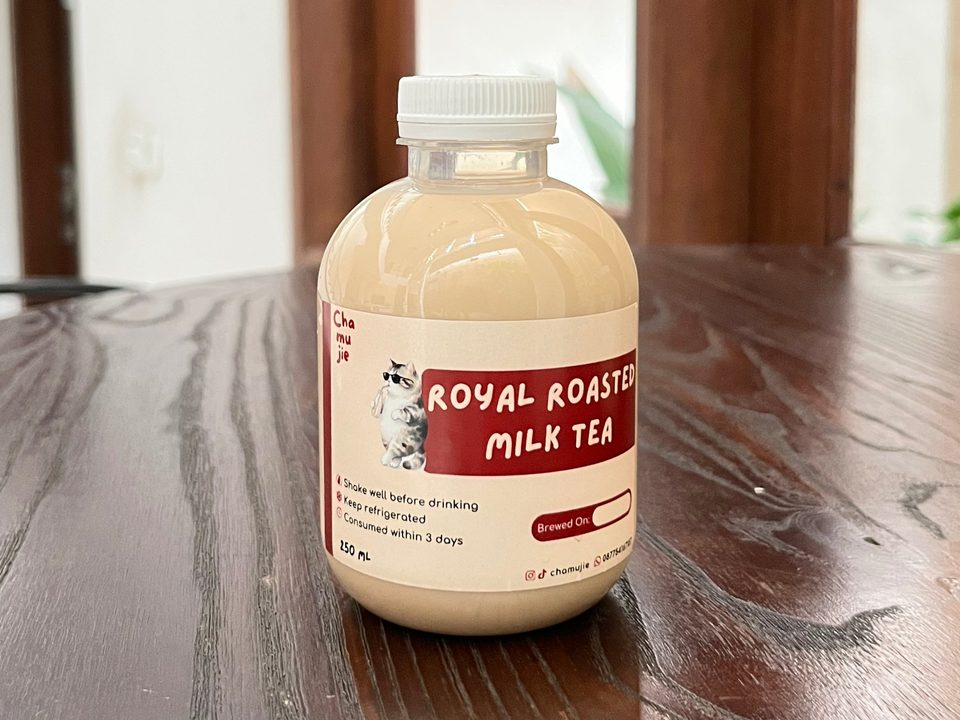
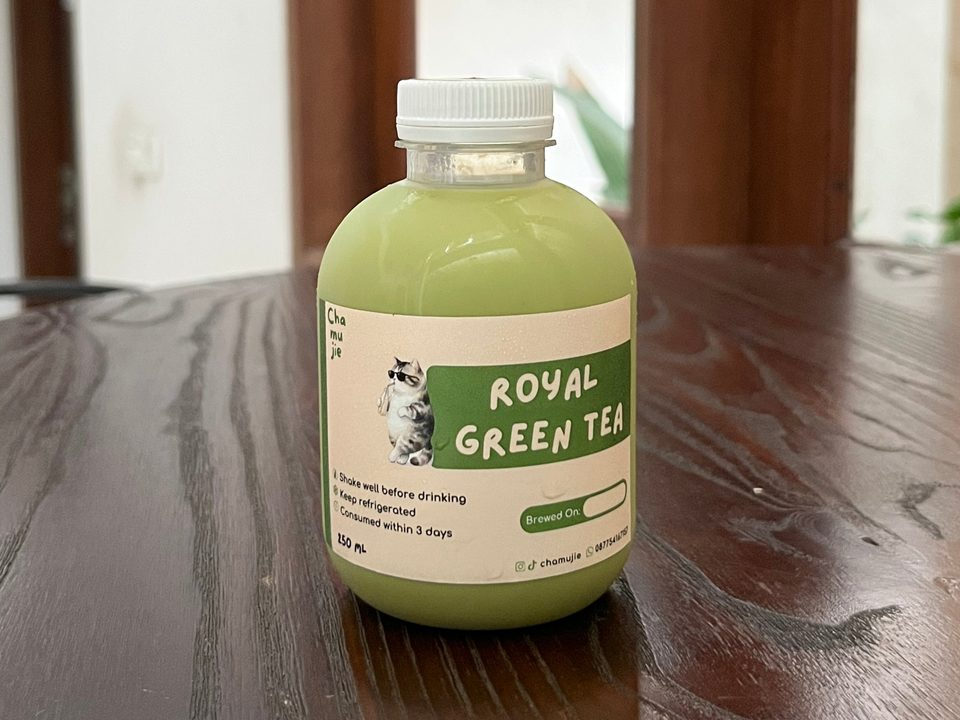
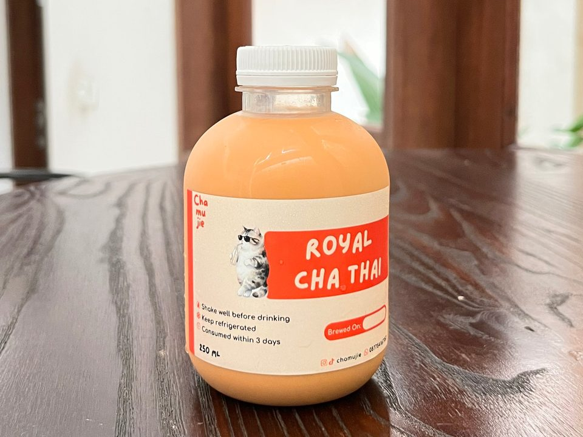

<p align="center">
  
</p>

<h1 align="center">Chamujie Website</h1>

<p align="center">
  Website katalog &amp; pemesanan <b>Chamujie Artisanal Roasted Milk Tea</b>, UMKM minuman teh panggang homemade dari Malang.
</p>

<p align="center">
  
  
  
  
</p>

---

## Tentang Chamujie

Chamujie memproduksi **roasted milk tea** dalam botol 250 ml, 500 ml, dan 1 L. Daun teh dipanggang perlahan lalu diseduh bersama susu segar, dibuat sesuai pesanan (*made-to-order*) dan diproses maksimal 2 hari.

| Menu | Deskripsi singkat |
|---|---|
| **Royal Roasted Milk Tea** | Teh hitam dan oolong panggang, susu segar, sentuhan karamel gula aren |
| **Royal Green Tea** | Teh hijau panggang yang segar dengan susu creamy |
| **Royal Cha Thai** | Thai tea dengan rasa rempah hangat dan susu segar |

<p align="center">
  
  
  
</p>

Chamujie dijual lewat dua jalur:

- **Online:** promosi di Instagram, TikTok, dan Threads, lalu pemesanan lewat WhatsApp.
- **Offline:** titip jual (konsinyasi) di toko mitra dan booth bazaar atau Car Free Day.

## Latar Belakang Proyek

Proyek ini dikerjakan untuk mata kuliah **Manajemen Proyek Tangkas (MPT A), Kelompok 08**, Departemen Sistem Informasi.

Dari wawancara dengan mitra, masalah utama Chamujie adalah produknya **belum banyak dikenal**, sehingga penjualan masih sedikit. Pemilik juga mengerjakan produksi dan pemasaran sendiri. Website ini dibuat untuk:

1. Memperkenalkan produk beserta keunggulannya (rasa dan harga yang bersaing).
2. Menyediakan katalog digital dengan pemesanan yang rapi ke WhatsApp.
3. Menampilkan toko mitra konsinyasi serta jadwal event dan bazaar.

## Fitur

| Section | Fitur |
|---|---|
| **Navbar** | Navigasi antar-section, penanda section aktif, menu hamburger di HP, tombol keranjang |
| **Hero** | Headline, tombol *Pesan Sekarang* dan *Cek Event Terdekat*, status slot Pre-Order (*Available / Limited / Fully Booked*) |
| **How to Order** | Alur pemesanan 4 langkah, info proses PO, pengiriman, dan opsi beli langsung |
| **Catalog Menu** | Kartu produk dengan badge (*Best Seller, Limited Batch, New Release*), filter kategori, status *Habis* |
| **Detail Menu (modal)** | Pilihan ukuran botol, tingkat gula 0–100%, catatan khusus, jumlah, total otomatis |
| **Cart** | Keranjang sementara, form nama dan metode (Delivery / Self-Pickup), preview pesan WhatsApp, Copy Text |
| **WhatsApp** | Satu klik mengirim format pesanan yang rapi ke WhatsApp admin (*click-to-chat* `wa.me`) |
| **Stores &amp; Bazaar** | Tab toko mitra dan event, tautan Google Maps, event yang sudah lewat tersembunyi otomatis |
| **Footer** | Identitas brand dan tautan Instagram serta Threads |

### Rencana pengembangan

- [ ] Data produk, stok, toko, event, dan slot PO dibaca dari **Google Sheets**, supaya pemilik cukup mengubah isi sheet tanpa menyentuh kode.
- [ ] Keranjang tersimpan saat halaman di-refresh.
- [ ] Peta digital tertanam untuk lokasi toko dan event.

## Teknologi

- [Laravel 12](https://laravel.com) dengan Blade
- [Tailwind CSS 4](https://tailwindcss.com) dan [Vite](https://vitejs.dev)
- JavaScript tanpa framework
- SQLite (bawaan Laravel; data website saat ini belum memakai database)

## Menjalankan di Komputer Sendiri

### Prasyarat

- PHP **8.2** atau lebih baru, dengan ekstensi `zip`, `fileinfo`, `mbstring`, `openssl`, `curl`, `pdo_sqlite`, `sqlite3`
- [Composer](https://getcomposer.org) 2.x
- [Node.js](https://nodejs.org) versi LTS (sudah termasuk `npm` dan `npx`)
- Git

### Instalasi

```bash
git clone https://github.com/<username>/chamujie-website.git
cd chamujie-website

composer install
npm install

cp .env.example .env        # Windows: copy .env.example .env
php artisan key:generate
```

### Menjalankan (mode pengembangan)

Buka **dua terminal** dan biarkan keduanya berjalan:

```bash
# Terminal 1
php artisan serve

# Terminal 2
npm run dev
```

Buka `http://127.0.0.1:8000`.

### Atau build sekali

```bash
npm run build
php artisan serve
```

Jalankan `npm run build` lagi setiap kali tampilan atau JavaScript diubah.

### Catatan untuk Windows

- **`composer run dev` berhenti dengan error Pail** (`The [pcntl] extension is required`). Pail tidak bisa berjalan di Windows. Pakai cara dua terminal di atas.
- **`npm` diblokir PowerShell** (`running scripts is disabled`). Jalankan sekali:
  ```powershell
  Set-ExecutionPolicy -Scope CurrentUser RemoteSigned
  ```
  atau pakai Command Prompt.
- **Tampilan polos tanpa gaya** dan konsol berisi `ERR_CONNECTION_REFUSED` ke port `5173`. Vite tidak sedang berjalan tetapi file `public/hot` masih ada. Hapus file itu, lalu jalankan `npm run build` atau `npm run dev`.

## Mengubah Data Website

Semua data yang tampil di website ada di **`config/chamujie.php`**:

| Kunci | Isi |
|---|---|
| `wa_number` | Nomor WhatsApp admin, format `62...` |
| `products` | Nama, kategori, deskripsi, badge, gambar, dan ketersediaan menu |
| `sizes` | Ukuran botol dan harganya |
| `po` | Status dan jadwal slot Pre-Order |
| `stores` | Toko mitra konsinyasi |
| `bazaars` | Jadwal event dan bazaar (`date` dengan format `YYYY-MM-DD`) |
| `socials` | Tautan Instagram dan Threads |

Gambar produk disimpan di `public/images/`.

## Struktur Folder Utama

```
config/chamujie.php              data website
routes/web.php                   route halaman utama
resources/
├── css/app.css                  tema warna dan font (Tailwind)
├── js/app.js                    modal, keranjang, WhatsApp, navbar, filter
└── views/
    ├── layouts/app.blade.php    head, navbar, footer
    ├── home.blade.php           susunan section
    └── sections/                hero, menu, about, how, locations, cart
public/images/                   logo dan foto produk
```

## Kontak Chamujie

- Instagram: [@chamujie](https://instagram.com/chamujie)
- Threads: [@chamujie](https://www.threads.com/@chamujie)
- TikTok: [@chamujie](https://www.tiktok.com/@chamujie)

---

<sub>Dibuat untuk keperluan akademik mata kuliah Manajemen Proyek Tangkas. Logo, foto produk, dan merek Chamujie adalah milik Chamujie.</sub>
